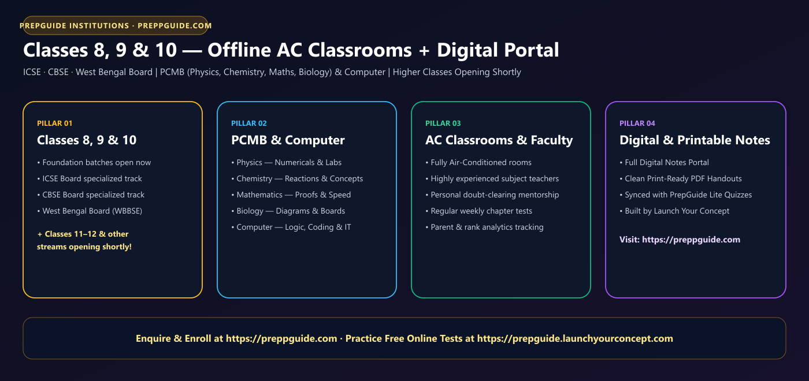
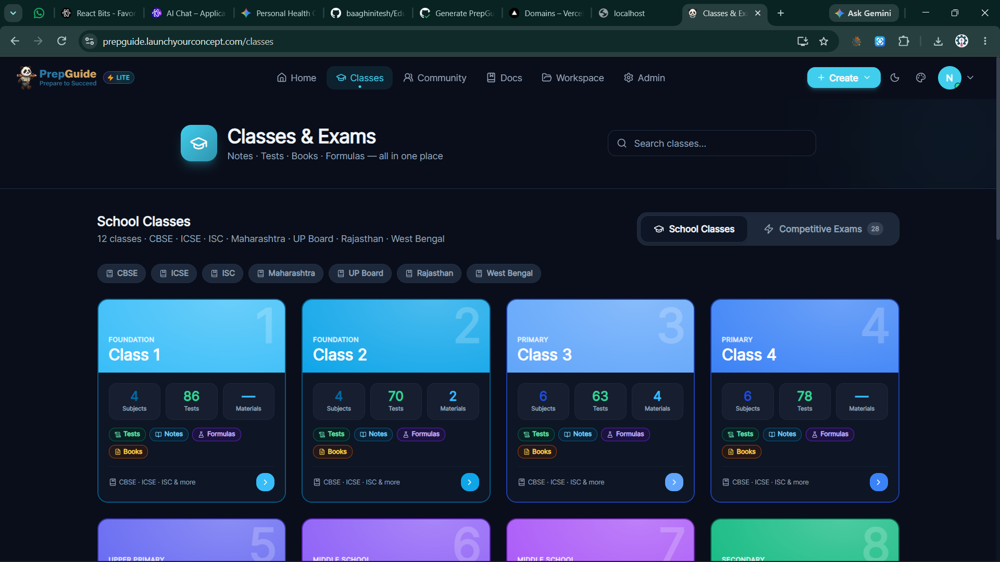
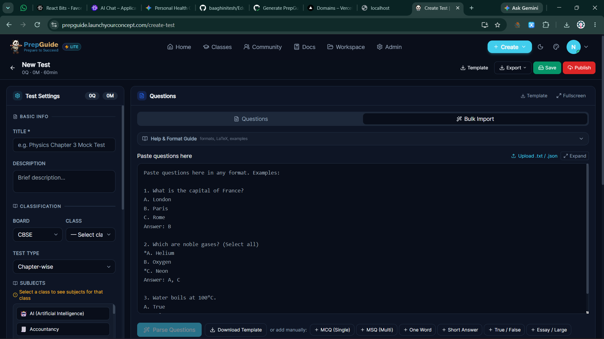
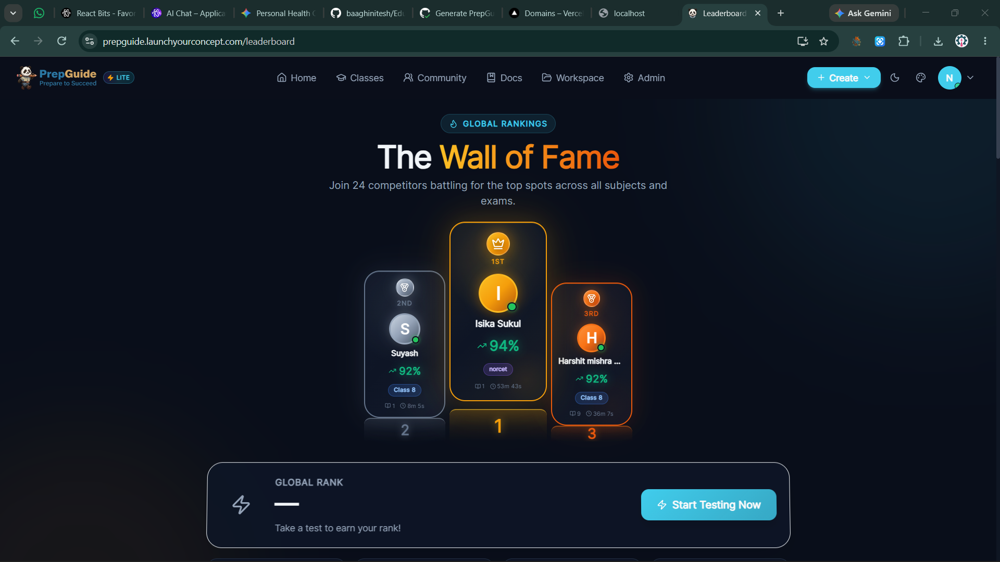
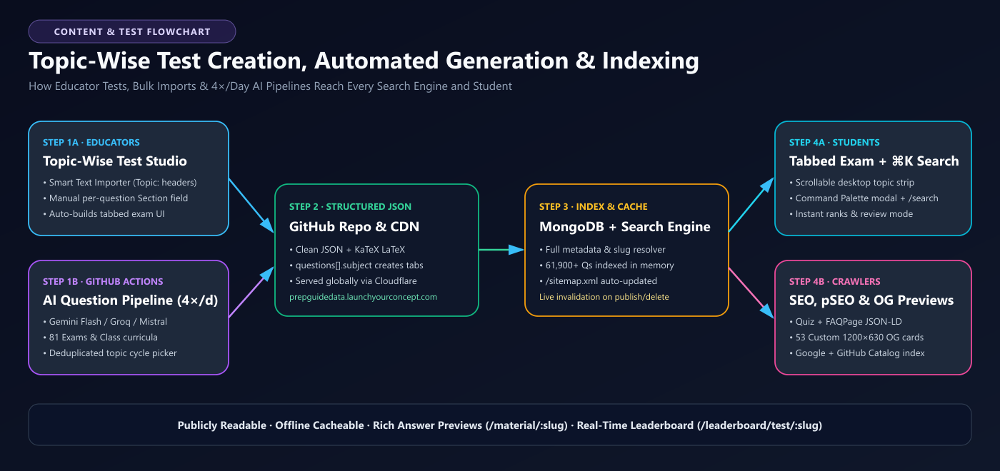
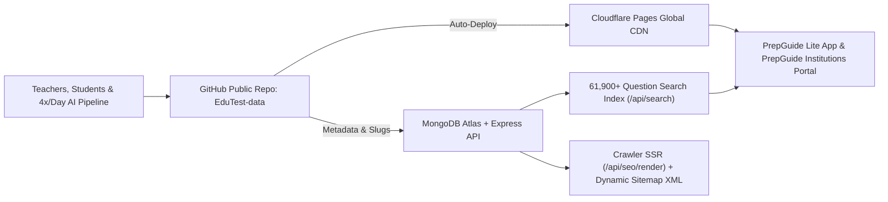

<div align="center">


<pre>
██████╗ ██████╗ ███████╗██████╗  ██████╗ ██╗   ██╗██╗██████╗ ███████╗    ██╗     ██╗████████╗███████╗
██╔══██╗██╔══██╗██╔════╝██╔══██╗██╔════╝ ██║   ██║██║██╔══██╗██╔════╝    ██║     ██║╚══██╔══╝██╔════╝
██████╔╝██████╔╝█████╗  ██████╔╝██║  ███╗██║   ██║██║██║  ██║█████╗      ██║     ██║   ██║   █████╗  
██╔═══╝ ██╔══██╗██╔══╝  ██╔═══╝ ██║   ██║██║   ██║██║██║  ██║██╔══╝      ██║     ██║   ██║   ██╔══╝  
██║     ██║  ██║███████╗██║     ╚██████╔╝╚██████╔╝██║██████╔╝███████╗    ███████╗██║   ██║   ███████╗
╚═╝     ╚═╝  ╚═╝╚══════╝╚═╝      ╚═════╝  ╚═════╝ ╚═╝╚═════╝ ╚══════╝    ╚══════╝╚═╝   ╚═╝   ╚══════╝
</pre>

<h3>PrepGuide Lite — Free Public Mock Tests, Notes &amp; Open Question Bank CDN</h3>

<p>
  <strong>100% Free Public Test Creation, Question Bank &amp; Digital Notes Ecosystem Powering <a href="https://prepguide.launchyourconcept.com">PrepGuide Lite</a></strong><br/>
  <strong>1,975+ Mock Tests</strong> &amp; <strong>81,541+ MCQ/MSQ Questions</strong> across <strong>81 School Classes &amp; Competitive Exams</strong> — served worldwide on Cloudflare Pages CDN.<br/>
  Built &amp; Maintained by <a href="https://www.launchyourconcept.com"><strong>Launch Your Concept</strong></a> · Classroom + Digital Institute: <a href="https://preppguide.com"><strong>PrepGuide Institutions</strong></a>
</p>

<p>
  <a href="https://prepguide.launchyourconcept.com">
    
  </a>
  <a href="https://preppguide.com">
    
  </a>
  <a href="https://prepguidedata.launchyourconcept.com/test.json">
    
  </a>
  <a href="./CATALOG.md">
    
  </a>
  <a href="https://github.com/baaghinitesh/EduTest-data/actions/workflows/generate-content.yml">
    
  </a>
</p>

<br/>


</div>

---

## Our Story & Complete Ecosystem

<div align="center">
  
</div>

### 1. PrepGuide Lite — 100% Free Public Test & Study Platform
**[PrepGuide Lite](https://prepguide.launchyourconcept.com)** is built so every student and teacher across India can **create tests for free**, **write & publish study notes**, and **practice real exam-style mock papers** without paywalls:
- **Classes 1–12 across 7 Boards:** CBSE, ICSE, ISC, West Bengal Board, Maharashtra Board, UP Board, Rajasthan Board
- **28+ National & State Competitive Exams:** AIIMS NORCET, NEET UG, NEET PG, JEE Mains, JEE Advanced, UPSC CSE, UPSC CAPF, SSC CGL/CHSL/MTS, IBPS PO/Clerk, SBI PO, RRB NTPC/Group D, CAT, GATE, CLAT, NDA, CDS, CUET UG/PG, CTET, DSSSB, KVPY, Olympiads
- **Command Search (`⌘K`) & Dynamic Smart Search:** Instant search across **61,900+ indexed MCQ/MSQ questions**, topic hubs ([/topics](https://prepguide.launchyourconcept.com/topics)), and interactive explanations ([/search](https://prepguide.launchyourconcept.com/search))
- **Topic-Wise Tabbed Exam Studio:** Educators paste bulk papers with `Topic:` / `Section:` headers or assign manual per-question topics — automatically creating clean multi-section exam tabs

---

### 2. PrepGuide Institutions — Classes 8, 9 & 10 Classroom + Digital Coaching

<div align="center">
  <a href="https://preppguide.com">
    
  </a>
  <br/><br/>
  
</div>

<table>
  <tr>
    <td width="220" align="center">
      <a href="https://preppguide.com">
        
      </a>
    </td>
    <td>
      <strong><a href="https://preppguide.com">PrepGuide Institutions</a></strong> pairs focused offline classroom teaching with our full digital &amp; printable study portal:<br/>
      • <strong>Now Opening For:</strong> <strong>Classes 8, 9 &amp; 10</strong> <em>(higher &amp; other classes opening shortly!)</em><br/>
      • <strong>Boards Covered:</strong> <strong>ICSE · CBSE · West Bengal Board (WBBSE)</strong><br/>
      • <strong>Subjects:</strong> <strong>PCMB (Physics, Chemistry, Mathematics, Biology) &amp; Computer</strong><br/>
      • <strong>Facilities:</strong> <strong>Air-Conditioned (AC) Classrooms</strong>, <strong>Highly Experienced Teachers</strong>, and a <strong>Full Digital &amp; Printable Notes Platform</strong><br/>
      • <strong>Website &amp; Quiz:</strong> <a href="https://preppguide.com"><strong>https://preppguide.com</strong></a> · <a href="https://prepguide.launchyourconcept.com/material/prepguide-institutions-intro-readiness-quiz-9e4c7a50"><strong>Take PrepGuide Institutions Intro &amp; PCMB Quiz</strong></a>
    </td>
  </tr>
</table>

---

### 3. Developed & Maintained by Launch Your Concept

<table>
  <tr>
    <td width="220" align="center">
      <a href="https://www.launchyourconcept.com">
        
      </a>
    </td>
    <td>
      <strong><a href="https://www.launchyourconcept.com">Launch Your Concept</a></strong> engineers, hosts, and maintains both <strong>PrepGuide Lite</strong> and <strong>PrepGuide Institutions</strong> — owning full-stack platform architecture, Cloudflare Pages CDN pipelines, in-memory question search indexing, SEO/pSEO automation, and continuous feature delivery.<br/>
      • Website: <a href="https://www.launchyourconcept.com"><strong>https://www.launchyourconcept.com</strong></a>
    </td>
  </tr>
</table>

---

## PrepGuide App Screenshots Showcase

<table>
  <tr>
    <td width="50%" align="center">
      <a href="https://prepguide.launchyourconcept.com/classes">
        
      </a><br/>
      <strong>All School Classes (1–12) &amp; Competitive Exams Explorer</strong><br/>
      <sub>Browse 7 boards and 28+ exams with live mock test &amp; study material counters.</sub>
    </td>
    <td width="50%" align="center">
      <a href="https://prepguide.launchyourconcept.com/create-test">
        
      </a><br/>
      <strong>Topic-Wise Manual &amp; Bulk Test Creation Studio</strong><br/>
      <sub>Assign sections/topics per question or via smart text import with LaTeX support.</sub>
    </td>
  </tr>
  <tr>
    <td width="50%" align="center">
      <a href="https://prepguide.launchyourconcept.com/exam/norcet">
        
      </a><br/>
      <strong>Interactive Multi-Section Exam Portal</strong><br/>
      <sub>Scrollable topic tabs, color-coded palette, hints, negative marking &amp; real-time sync.</sub>
    </td>
    <td width="50%" align="center">
      <a href="https://prepguide.launchyourconcept.com/leaderboard">
        
      </a><br/>
      <strong>Global, Class, Exam &amp; Per-Test Leaderboards</strong><br/>
      <sub>Live rank calculations by score, percentage, and fastest completion time.</sub>
    </td>
  </tr>
</table>

---

## System Architecture & Content Flow Diagrams

<div align="center">
  
  <br/><br/>
  
</div>



---

## Indexable Design Docs & Complete SEO Catalog

| Document | Contents |
|---|---|
| **[CATALOG.md](./CATALOG.md)** | **Full SEO-Indexable Catalog** of all **1,975+ Tests** &amp; **81,541+ Questions** with direct practice, preview &amp; CDN JSON links |
| **[docs/PREPGUIDE_SYSTEM_DESIGN.md](./docs/PREPGUIDE_SYSTEM_DESIGN.md)** | Complete System Design, App Walkthrough, Search Index, Crawler SSR, OG Cards &amp; PrepGuide Institutions Architecture |
| **[docs/architecture.md](./docs/architecture.md)** | Hybrid MongoDB + GitHub + Cloudflare CDN + Offline IndexedDB Architecture |
| **[docs/github-cdn.md](./docs/github-cdn.md)** | Static JSON Publishing Schema &amp; Cloudflare CDN Delivery Reference |
| **[docs/classes-and-exams-reference.md](./docs/classes-and-exams-reference.md)** | Full Registry of 81 School Classes &amp; Competitive Exams |
| **[topics/](./topics/)** | Machine-Readable Curriculum &amp; Chapter Registry across all Boards &amp; Exams |

---

## Repository Structure

```text
EduTest-data/
├── README.md                        # Main SEO Hub (PrepGuide Lite, Institutions, Launch Your Concept)
├── CATALOG.md                       # Complete SEO-indexed table of all tests across 81 curricula
├── _headers                         # Cloudflare CORS config (Access-Control-Allow-Origin: *)
├── test.json                        # CDN health-check endpoint
├── assets/
│   ├── diagrams/                    # High-res System Architecture, Flowchart & Blended Model PNGs
│   ├── prepguide-app-ss/            # App screenshots (Exam UI, Test Studio, Classes, Leaderboard)
│   └── *.png                        # Brand logos & 1200x630 banners
├── docs/
│   ├── PREPGUIDE_SYSTEM_DESIGN.md   # Deep architecture & product design documentation
│   ├── architecture.md
│   ├── github-cdn.md
│   └── classes-and-exams-reference.md
├── data/
│   ├── admin/{classSlug}/tests/     # Official tests (e.g. norcet, neet-ug, jee-mains, cbse-class-10)
│   ├── teacher/                     # Educator-contributed tests & notes
│   ├── student/                     # Student-contributed tests & notes
│   ├── research/                    # Cached syllabus & exam-pattern research
│   └── drafts/                      # Resumable generation drafts
├── topics/                          # Structured syllabus registry (school/ + competitive/)
├── scripts/                         # Python AI content generation & publish pipeline
└── .github/workflows/
    └── generate-content.yml         # Scheduled 4x/day GitHub Actions workflow
```

---

## Direct Cloudflare CDN Examples

Cloudflare Pages serves every JSON file with `Access-Control-Allow-Origin: *` (configured in [`_headers`](./_headers)):

```bash
# CDN health check
curl https://prepguidedata.launchyourconcept.com/test.json

# PrepGuide Institutions Official Intro & PCMB Readiness Quiz
curl https://prepguidedata.launchyourconcept.com/data/admin/cbse-class-10/tests/prepguide-institutions-intro-readiness-quiz-9e4c7a50.json

# NORCET FON Infection Control & Biomedical Waste Management (70Q)
curl https://prepguidedata.launchyourconcept.com/data/admin/norcet/tests/norcet-fon-infection-control-hand-hygiene-ppe-cssd-bmw-70q-9e4c7a30.json
```

---

## Automated Generation Schedule (GitHub Actions)

[`generate-content.yml`](./.github/workflows/generate-content.yml) runs **4 times daily** (plus manual `workflow_dispatch` runs):

| Schedule (UTC) | Time (IST) | Mode | Purpose |
|---|---|---|---|
| `30 0 * * *` | 6:00 AM IST | `full` | Full-length mock test generation |
| `30 6 * * *` | 12:00 PM IST | `subject` | Subject-wise / combined tests |
| `30 11 * * *` | 5:00 PM IST | `subject` | Subject-wise / combined (post-quota reset) |
| `30 15 * * *` | 9:00 PM IST | `subject` | Subject-wise / combined tests |

---

<div align="center">

<h3>PrepGuide Ecosystem Partners</h3>

<table>
  <tr>
    <td align="center" width="33%">
      <a href="https://prepguide.launchyourconcept.com">
        <br/>
        <strong>PrepGuide Lite</strong>
      </a><br/>
      <sub>Free Tests, Notes &amp; Study Engine</sub>
    </td>
    <td align="center" width="34%">
      <a href="https://preppguide.com">
        <br/>
        <strong>PrepGuide Institutions</strong>
      </a><br/>
      <sub>Classes 8–10 · ICSE, CBSE, WBBSE · PCMB &amp; CS</sub>
    </td>
    <td align="center" width="33%">
      <a href="https://www.launchyourconcept.com">
        <br/>
        <strong>Launch Your Concept</strong>
      </a><br/>
      <sub>Platform Development &amp; Maintenance</sub>
    </td>
  </tr>
</table>

<strong><a href="https://prepguide.launchyourconcept.com">prepguide.launchyourconcept.com</a></strong> ·
<strong><a href="https://preppguide.com">preppguide.com</a></strong> ·
Built by <strong><a href="https://www.launchyourconcept.com">Launch Your Concept</a></strong>

</div>
