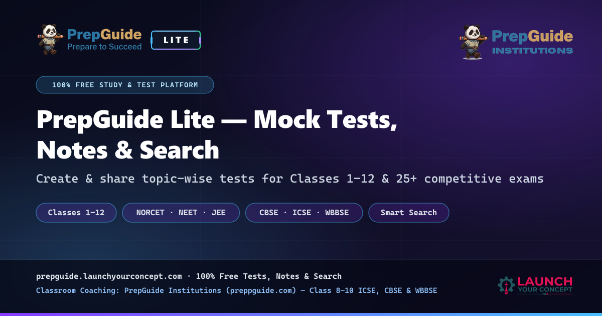
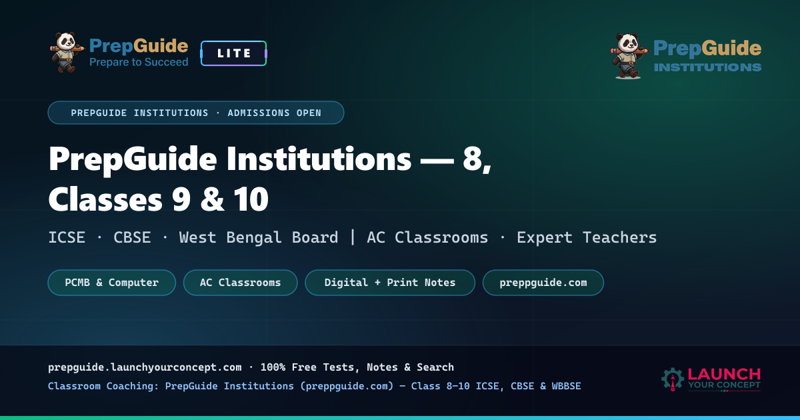

<div align="center">


<h3>PrepGuide Lite — Free Public Test, Notes &amp; Open Question Bank</h3>

<p>
  <strong>Static JSON Content Bank Powering <a href="https://prepguide.launchyourconcept.com">PrepGuide Lite</a> — Built &amp; Maintained by <a href="https://www.launchyourconcept.com">Launch Your Concept</a></strong><br/>
  2,000+ curated mock tests &amp; 61,900+ searchable MCQ/MSQ questions across 81 school classes &amp; competitive exams — served globally via Cloudflare Pages CDN.
</p>

<p>
  <a href="https://prepguide.launchyourconcept.com">
    
  </a>
  <a href="https://preppguide.com">
    
  </a>
  <a href="https://prepguidedata.launchyourconcept.com/test.json">
    
  </a>
  <a href="https://github.com/baaghinitesh/EduTest-data/actions/workflows/generate-content.yml">
    
  </a>
  <a href="https://www.launchyourconcept.com">
    
  </a>
</p>

<br/>



</div>

---

## Our Story & Ecosystem

### 1. PrepGuide Lite — Free Public Test Creation, Notes & Study Platform
**[PrepGuide Lite](https://prepguide.launchyourconcept.com)** is a **100% free educational platform** where students and teachers across India can create, publish, search, and practice tests and study notes at zero cost:
- **Create Topic-Wise (Tabbed) Mock Tests for Free** — Build multi-section tests cleanly using bulk Smart Text Import (`Topic:` / `Section:` headers) or per-question topics
- **Smart In-App Search Engine** — Instant keyword search across 61,900+ questions, tests, notes, formulas & books at [`/search`](https://prepguide.launchyourconcept.com/search)
- **All Boards & Competitive Exams** — Full coverage of **Classes 1–12** (CBSE, ICSE, ISC, West Bengal, Maharashtra, UP Board, Rajasthan) plus **28+ Competitive Exams** (NORCET, NEET UG/PG, JEE Mains/Advanced, UPSC, SSC, Banking, Railways, CAT, GATE, CLAT, NDA, CDS, CUET, Olympiads)

---

### 2. PrepGuide Institutions — Classes 8, 9 & 10 Classroom + Digital Coaching
<div align="center">
  <a href="https://preppguide.com">
    
  </a>
</div>

<p>
  <a href="https://preppguide.com">
    
  </a>
  <strong><a href="https://preppguide.com">PrepGuide Institutions</a></strong> brings focused offline classroom excellence paired seamlessly with a complete digital &amp; printable notes platform:<br/>
  • <strong>Admissions Opening For:</strong> <strong>Classes 8, 9 &amp; 10</strong> <em>(higher &amp; additional classes opening shortly!)</em><br/>
  • <strong>Supported Boards:</strong> <strong>ICSE · CBSE · West Bengal Board (WBBSE)</strong><br/>
  • <strong>Subjects Offered:</strong> <strong>PCMB (Physics, Chemistry, Mathematics, Biology) &amp; Computer</strong><br/>
  • <strong>Learning Environment:</strong> <strong>AC Classrooms</strong>, <strong>Highly Experienced Teachers</strong>, and a <strong>Full Digital &amp; Printable Notes Platform</strong><br/>
  • <strong>Official Website:</strong> <a href="https://preppguide.com"><strong>https://preppguide.com</strong></a> · <a href="https://prepguide.launchyourconcept.com/material/prepguide-institutions-intro-readiness-quiz-9e4c7a50"><strong>Take the Free Institutions Intro &amp; PCMB Readiness Quiz</strong></a>
</p>
<br clear="left" />

---

### 3. Developed & Maintained by Launch Your Concept
<p>
  <a href="https://www.launchyourconcept.com">
    
  </a>
  <strong><a href="https://www.launchyourconcept.com">Launch Your Concept</a></strong> handles full-stack engineering, cloud CDN infrastructure, search &amp; pSEO architecture, and ongoing platform maintenance for both <strong>PrepGuide Lite</strong> and <strong>PrepGuide Institutions</strong>.<br/>
  Visit: <a href="https://www.launchyourconcept.com"><strong>https://www.launchyourconcept.com</strong></a>
</p>
<br clear="left" />

---

## System Architecture

```text
┌────────────────────────────────────────────────────────────────┐
│           PrepGuide Lite Client (React + Vite + PWA)           │
│   IndexedDB Offline · KaTeX · Topic Tabs · Smart Search        │
└──────────────────────────┬─────────────────────────────────────┘
                           │
        ┌──────────────────┴──────────────────┐
        │ Metadata, Search & Crawler SSR      │ Full Test / Note JSON
        ▼                                     ▼
┌────────────────────────┐      ┌──────────────────────────────────┐
│  Express + MongoDB API │      │  Cloudflare Pages Global CDN     │
│  (/api/search, /seo)   │      │  prepguidedata.launchyourconcept │
└───────────┬────────────┘      └─────────────────▲────────────────┘
            │ @octokit/rest                       │ Auto-deploy on push
            └──────────────► GitHub: EduTest-data ◄── GitHub Actions (4x/day)
```

### Key Engineering Highlights
- **Zero-Cost Global Read Scale** — Served from 300+ Cloudflare edge locations with CORS enabled (`_headers`)
- **Offline-First Ready** — Designed to cache seamlessly inside the client's IndexedDB (`prepguide-offline`)
- **Rich Math & Science Support** — Full KaTeX / LaTeX formulas (`$...$`, `$$...$$`), hints, step-by-step explanations, and per-option breakdowns
- **Search & pSEO Indexable** — Dynamic XML sitemap (`/sitemap.xml`), crawler SSR (`/api/seo/render`), topic hubs (`/topics`, `/topic/:slug`), and 53+ custom social OG images
- **Automated Daily Growth** — GitHub Actions runs 4× daily to research topics, generate exam-aligned questions, structure JSON, and publish to both CDN and MongoDB metadata

---

## Repository Structure

```text
EduTest-data/
├── assets/                          # PrepGuide Lite, PrepGuide Institutions & Launch Your Concept logos/banners
├── docs/                            # Synced architecture & GitHub-CDN documentation
├── _headers                         # Cloudflare CORS config (Access-Control-Allow-Origin: *)
├── test.json                        # CDN health-check endpoint
├── data/
│   ├── admin/                       # Official PrepGuide Lite & Institutions content (by exam/class slug)
│   │   ├── cbse-class-10/tests/     # e.g. PrepGuide Institutions quiz & board mock tests
│   │   ├── norcet/tests/            # NORCET Nursing FON infection control & clinical tests
│   │   ├── jee-mains/tests/         # Full-length, combined & subject-wise tests
│   │   ├── neet-ug/tests/
│   │   ├── upsc-cse/tests/
│   │   └── ... (81 exams & classes)
│   ├── teacher/                     # Educator-published tests & notes
│   ├── student/                     # Student-published tests & notes
│   ├── research/                    # Cached syllabus & exam-pattern research
│   └── drafts/                      # In-progress generation drafts (resumed automatically)
├── topics/                          # Structured syllabus registry (81 curricula)
│   ├── school/                      # CBSE, ICSE, ISC, Maharashtra, UP, Rajasthan, West Bengal (Classes 1–12)
│   └── competitive/                 # JEE, NEET, UPSC, GATE, CAT, SSC, IBPS, SBI, RRB, NDA, CDS, CLAT, NORCET, etc.
├── scripts/                         # Python multi-provider test generation & publishing pipeline
│   ├── generate.py                  # Main orchestrator (resumes drafts → generates new tests)
│   ├── content_builder.py           # Exam-specific prompt builder, chunking & JSON assembly
│   ├── topic_picker.py              # Cycle-based topic selector (prevents duplicate topics)
│   ├── gemini_client.py             # Gemini Flash 2.5 / 2.0 multi-key rotation
│   ├── groq_client.py               # Groq Llama 3.3 70B structuring client
│   ├── mistral_client.py            # Mistral Small fallback client
│   ├── draft_store.py               # Partial-test persistence across runs
│   ├── research_cache.py            # Cached subject/topic exam research
│   └── publish_to_server.py         # Syncs metadata to PrepGuide Lite backend
└── .github/workflows/
    └── generate-content.yml         # Scheduled 4×/day GitHub Actions workflow
```

---

## Covered Exams & School Boards (`topics/`)

| Category | Coverage |
|---|---|
| **School Boards (Classes 1–12)** | CBSE, ICSE, ISC, Maharashtra Board, UP Board, Rajasthan Board, West Bengal Board |
| **Engineering & Science** | JEE Mains, JEE Advanced, GATE, CUET UG, CUET PG, KVPY, Math & Science Olympiads |
| **Medical & Nursing** | NEET UG, NEET PG, NORCET |
| **Civil Services & Defence** | UPSC CSE, UPSC CAPF, NDA, CDS |
| **SSC, Banking & Railways** | SSC CGL, SSC CHSL, SSC MTS, IBPS PO, IBPS Clerk, SBI PO, RRB NTPC, RRB Group D |
| **Management, Law & Teaching** | CAT, CLAT, CTET, DSSSB |

---

## Content JSON Schemas

### 1. Test JSON (`data/admin/{classSlug}/tests/{slug}-{shortId}.json`)

```json
{
  "id": "98bd07ae-9f65-4bee-8004-92b2c820f66b",
  "title": "CAT — Combined: Data Interpretation LR + Quantitative Aptitude",
  "description": "Combined test: Data Interpretation LR + Quantitative Aptitude for CAT. 30Q.",
  "board": "Competitive",
  "classSlug": "cat",
  "classNumber": 0,
  "subjects": ["cat-dilr", "cat-qa"],
  "subject": "cat-dilr",
  "chapter": "Multiple Chapters",
  "topic": "Combined",
  "testType": "subject-wise",
  "duration": 80,
  "totalMarks": 90,
  "passingMarks": 36,
  "totalQuestions": 30,
  "isPublic": true,
  "isPublished": true,
  "isAdmin": true,
  "showCorrectAnswers": true,
  "randomizeQuestions": false,
  "unlimitedAttempts": true,
  "allowedAttempts": 0,
  "tags": ["cat", "cat-dilr+cat-qa"],
  "instructions": [
    "Subject: Data Interpretation LR + Quantitative Aptitude",
    "Total Questions: 30",
    "Total Marks: 90",
    "Duration: 80 minutes"
  ],
  "createdBy": "admin",
  "createdByName": "PrepGuide Lite Admin",
  "publishedAt": "2026-05-01T10:00:00Z",
  "questions": [
    {
      "id": "q-uuid",
      "order": 1,
      "type": "mcq",
      "subject": "Topic / Section Name (renders as tabbed exam sections)",
      "question": "Question text with optional LaTeX like $E = mc^2$",
      "difficulty": "medium",
      "marks": 3,
      "negativeMarking": true,
      "negativeMark": 1,
      "hint": "Optional hint for students",
      "explanation": "Step-by-step deductive solution",
      "options": [
        { "letter": "A", "text": "Option A", "isCorrect": false, "index": 0, "explanation": "..." },
        { "letter": "B", "text": "Option B", "isCorrect": true,  "index": 1, "explanation": "..." },
        { "letter": "C", "text": "Option C", "isCorrect": false, "index": 2, "explanation": "..." },
        { "letter": "D", "text": "Option D", "isCorrect": false, "index": 3, "explanation": "..." }
      ]
    }
  ]
}
```

**Supported question types (`questions[].type`):** `mcq`, `msq`, `true-false`, `one-word`, `short-answer`, `large`.

### 2. Note / Formula / Resource JSON (`data/admin/{classSlug}/notes/{slug}-{shortId}.json`)

```json
{
  "id": "note-uuid",
  "title": "Quadratic Equations — Complete Formula Sheet",
  "description": "All key formulas and identities for Class 10 CBSE",
  "type": "note",
  "board": "CBSE",
  "classSlug": "cbse-class-10",
  "subject": "mathematics",
  "chapter": "Quadratic Equations",
  "tags": ["quadratic", "formula", "class10"],
  "isPublic": true,
  "isAdmin": true,
  "createdBy": "admin",
  "publishedAt": "2026-05-01T12:00:00Z",
  "content": "<p>Rich HTML + KaTeX content...</p>"
}
```

**Supported material types:** `note`, `formula`, `book`, `pdf`, `video`, `link`.

---

## Using the CDN Directly

Cloudflare Pages serves all JSON files with `Access-Control-Allow-Origin: *` (configured in [`_headers`](./_headers)):

```bash
# CDN health check
curl https://prepguidedata.launchyourconcept.com/test.json

# Fetch the PrepGuide Institutions Intro & PCMB Readiness Quiz
curl https://prepguidedata.launchyourconcept.com/data/admin/cbse-class-10/tests/prepguide-institutions-intro-readiness-quiz-9e4c7a50.json
```

---

## Automated Generation Schedule (GitHub Actions)

[`generate-content.yml`](./.github/workflows/generate-content.yml) runs **4 times daily** (and supports manual `workflow_dispatch` runs with optional `mode`, `exam`, `instructions`, and `max_tests`):

| Schedule (UTC) | Time (IST) | Mode | Purpose |
|---|---|---|---|
| `30 0 * * *` | 6:00 AM IST | `full` | Full-length mock test generation |
| `30 6 * * *` | 12:00 PM IST | `subject` | Subject-wise / combined tests |
| `30 11 * * *` | 5:00 PM IST | `subject` | Subject-wise / combined (post-quota reset) |
| `30 15 * * *` | 9:00 PM IST | `subject` | Subject-wise / combined tests |

---

<div align="center">
  
  &nbsp;&nbsp;&nbsp;
  
  &nbsp;&nbsp;&nbsp;
  
  <br/><br/>
  <strong>PrepGuide Lite</strong> (<a href="https://prepguide.launchyourconcept.com">prepguide.launchyourconcept.com</a>) ·
  <strong>PrepGuide Institutions</strong> (<a href="https://preppguide.com">preppguide.com</a>) ·
  Built by <a href="https://www.launchyourconcept.com"><strong>Launch Your Concept</strong></a>
</div>
