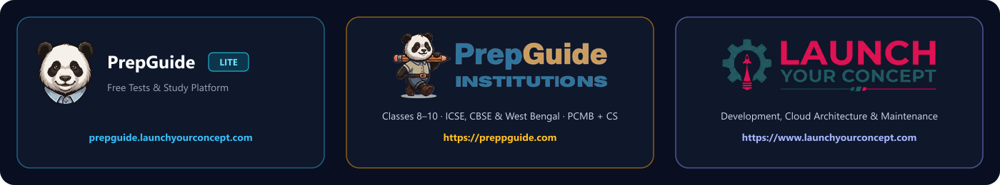
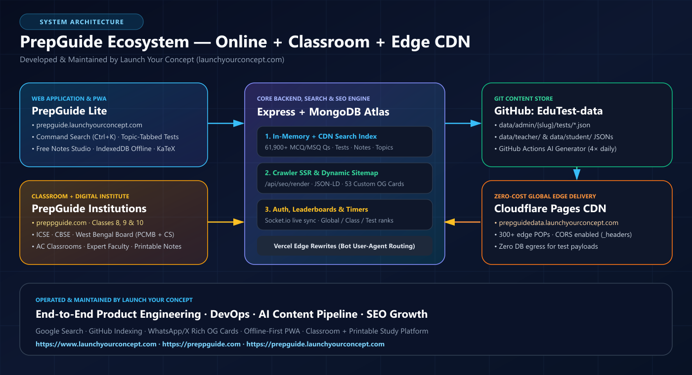
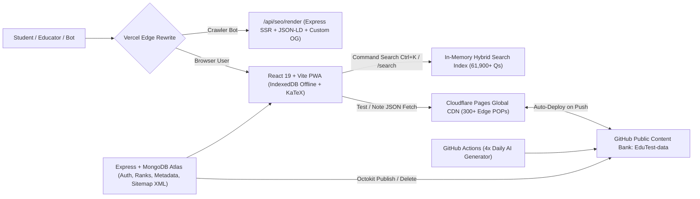
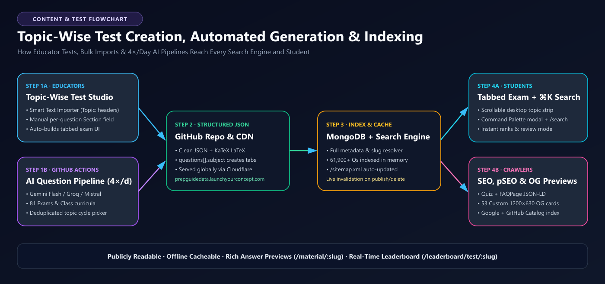
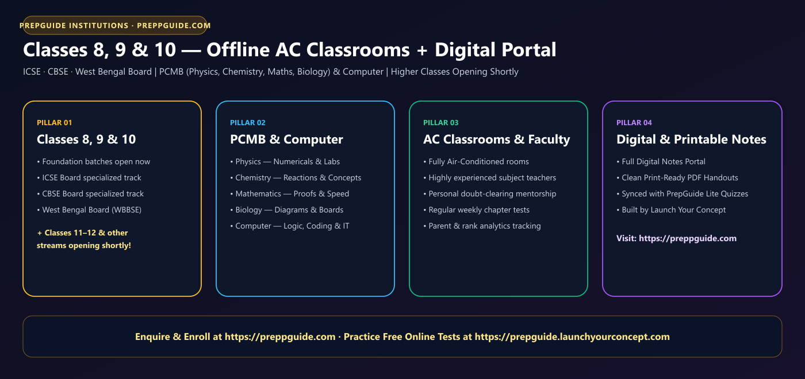
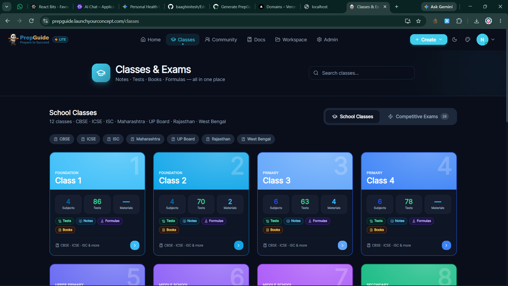
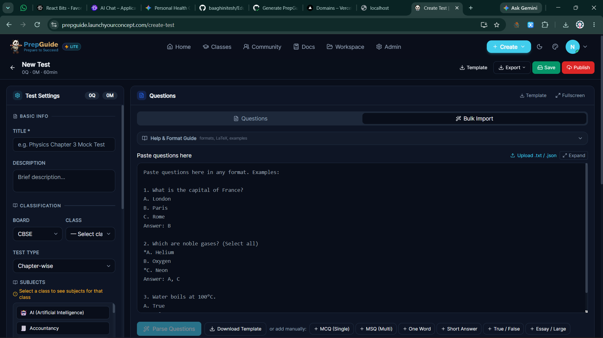
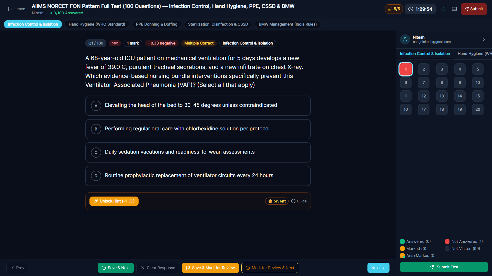
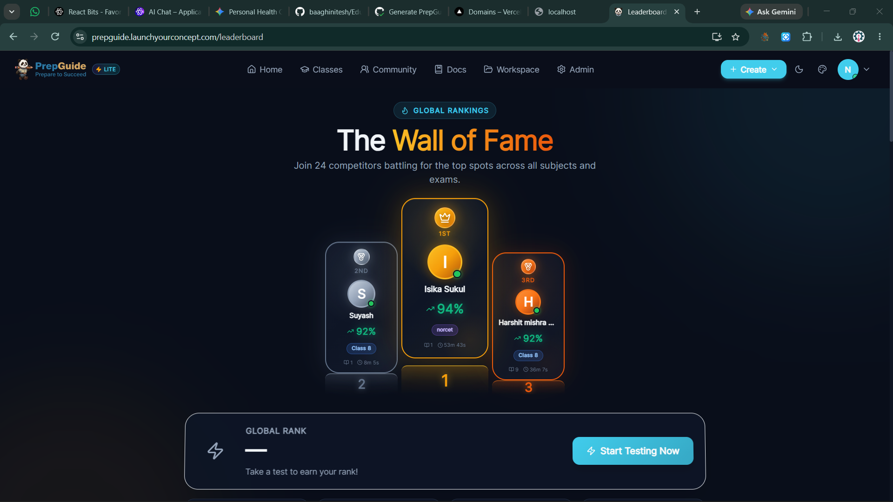

# PrepGuide Lite & PrepGuide Institutions — Complete System Design & Product Architecture

---

## 1. Executive Summary & Brand Ecosystem

The **PrepGuide Ecosystem** connects a free, nationwide digital assessment and study engine with structured physical + blended classroom coaching — engineered end-to-end by **Launch Your Concept**:

| Pillar | Platform / Brand | Mission & Audience | URL |
|---|---|---|---|
| **Digital Practice & Creation** | **PrepGuide Lite** | 100% free public test creator, tabbed topic-wise mock exam engine, digital notes studio, interactive formula sheets, smart search engine & live leaderboards for **Classes 1–12** (7 Boards) and **28+ Competitive Exams**. | [prepguide.launchyourconcept.com](https://prepguide.launchyourconcept.com) |
| **Classroom + Digital Coaching** | **PrepGuide Institutions** | Opening for **Classes 8, 9 & 10** across **ICSE, CBSE, and West Bengal Board** covering **PCMB & Computer** (*higher & other classes opening shortly*) featuring **AC classrooms**, **highly experienced teachers**, and a **full digital & printable notes platform**. | [preppguide.com](https://preppguide.com) |
| **Engineering & Maintenance** | **Launch Your Concept** | Product architecture, full-stack React + Node/Express + MongoDB development, Cloudflare Pages CDN infrastructure, SEO/pSEO automation, and continuous platform maintenance. | [www.launchyourconcept.com](https://www.launchyourconcept.com) |

---

## 2. Visual System Architecture

  

### Mermaid Request & Content Flow

---

## 3. Topic-Wise Mock Test Engine & Automated Content Pipeline

  

### How Tabbed Topic-Wise Exams Work
1. Every question object in `questions[]` supports an optional `subject` field (representing section/topic such as *Infection Control*, *Hand Hygiene*, *Biomedical Waste Management*, or *Quantitative Aptitude*).
2. **Creation Paths:**
   - **Smart Text Importer (`/create-test` → Bulk Import):** Authors can apply a batch section/topic header before importing OR include `Topic: ...` / `Section: ...` lines directly inside pasted raw text.
   - **Manual Question Editor:** Every individual question card exposes a **Section / Topic** input field so questions from multiple chapters coexist cleanly inside a single test.
3. **Runtime Exam UI (`ExamHeader.jsx` + `PalettePanel.jsx` + `ScrollableTabStrip.jsx`):**
   - Questions sharing a `subject` automatically group into clickable top section tabs and question-palette section tabs.
   - On desktop browsers, `ScrollableTabStrip` renders subtle left/right scroll buttons, vertical-to-horizontal wheel scrolling, and click-and-drag scrolling so users never need Shift+Scroll (mobile keeps native touch momentum).

---

## 4. PrepGuide Institutions — Blended Classroom + Digital Design

  

- **Target Cohorts (Phase 1 Admissions Open):** Classes **8, 9 & 10** across **ICSE**, **CBSE**, and **West Bengal Board (WBBSE)** *(higher classes & additional streams opening shortly)*.
- **Subject Focus:** Complete **PCMB** (*Physics, Chemistry, Mathematics, Biology*) + **Computer** foundations aligned both with board scoring rubrics and future JEE/NEET/competitive aptitude.
- **Infrastructure & Notes Ecosystem:** Air-conditioned classrooms, highly experienced subject teachers, and a synced **Digital & Printable Notes Platform** backed by PrepGuide Lite mock testing & live rank tracking ([Take Intro & Readiness Quiz](https://prepguide.launchyourconcept.com/material/prepguide-institutions-intro-readiness-quiz-9e4c7a50)).

---

## 5. Application UI & Screen Walkthrough

<table>
  <tr>
    <td width="50%" align="center">
       
      <strong>Classes 1–12 &amp; Competitive Exam Directory</strong> 
      Browse 7 School Boards and 28+ National Competitive Exams with live test/material counters.
    </td>
    <td width="50%" align="center">
       
      <strong>Topic-Wise Test Creation Studio</strong> 
      Create manual or bulk-imported tests with separate topic tabs, LaTeX math, negative marking &amp; instant publish.
    </td>
  </tr>
  <tr>
    <td width="50%" align="center">
       
      <strong>NTA / NORCET Pattern Tabbed Exam UI</strong> 
      Section tabs, question palette states, timer sync, hints, and scrollable desktop tab strips.
    </td>
    <td width="50%" align="center">
       
      <strong>Global, Class, Exam &amp; Test Leaderboards</strong> 
      Tie-broken scoring, percentage badges, completion speed rankings, and personal rank tracking.
    </td>
  </tr>
</table>

---

## 6. Smart Search (`⌘K`), Crawler SSR & SEO Architecture

1. **Command Search Modal (`CommandSearchModal.jsx`):** Theme-aware spotlight command palette accessible via Navbar or `Ctrl/Cmd+K` with keyboard navigation, `Recent` search history, `Jump to` quick tiles, and debounced live results from `GET /api/search`.
2. **Dynamic Smart Search Page (`/search`):** Full query-driven dashboard with dynamic Analytics cards (Mock Tests, Matched Questions, Discovered Topics, Study Materials), Difficulty toggles, Topic Hub deep-links (`/topic/:slug`), interactive inline Answer/Explanation reveals, and `SearchResultsPage` + `ItemList` schema.
3. **Search Engine Crawlability & Social Previews (`server/routes/seo.js` & `server/routes/content.js`):**
   - `vercel.json` rewrites crawler user-agents (`Googlebot`, `Bingbot`, `WhatsApp`, `Twitterbot`, `LinkedInBot`, `PerplexityBot`, `GPTBot`) on public routes to `/api/seo/render`.
   - Every public test (`/material/:slug`), exam (`/exam/:slug`), school class/board (`/class/:num/:board`), topic hub (`/topic/:slug`), and search page outputs full HTML + **Schema.org JSON-LD** (`Quiz`, `FAQPage`, `Course`, `BreadcrumbList`, `Article`) + its matched **1200×630 custom PNG/WebP OG card** (`/og/*.png`).
   - `/sitemap.xml` dynamically enumerates all public tests, materials, classes, boards, subjects, topic hubs, and attempted test leaderboards along with `<image:image>` sitemap image entries.
